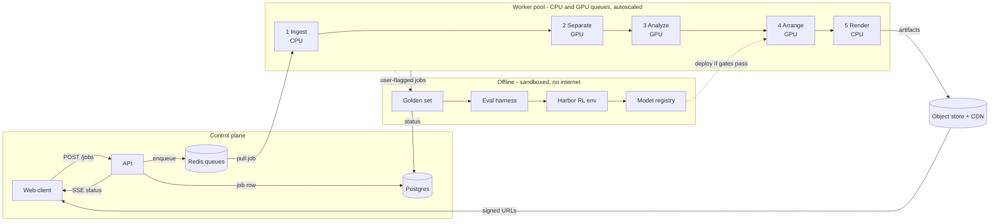
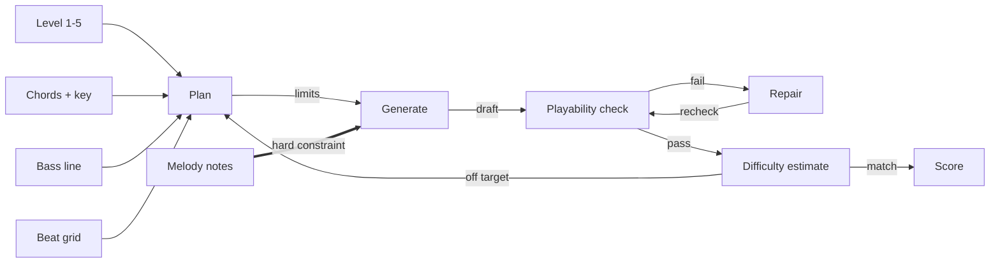

# ensheetification

Turn any song into a piano arrangement you can actually play.

Upload an audio file or paste a YouTube link, pick a difficulty level, and ensheetification produces a two-hand piano arrangement with:

- an in-browser player with a synced, scrolling score
- a downloadable **MIDI** file
- downloadable **PDF** sheet music (plus MusicXML for notation software)

The output is an *arrangement*, not a raw transcription: the melody is preserved, the harmony is re-voiced for piano, and every bar is checked to be playable by two human hands at the level you chose.

> **Status:** design phase. This README describes the target architecture. Sections marked *planned* describe intended behavior that is not built yet.

---

## Contents

- [How it works](#how-it-works)
- [Architecture](#architecture)
- [Pipeline stages](#pipeline-stages)
- [Arrangement engine](#arrangement-engine)
- [Difficulty levels](#difficulty-levels)
- [Evaluation](#evaluation)
- [Performance](#performance)
- [Scaling](#scaling)
- [Tech stack](#tech-stack)
- [Repository layout](#repository-layout)
- [Roadmap](#roadmap)

---

## How it works

1. **Submit** a file or URL with a difficulty level (1-5). The API creates a job and streams progress back to the browser.
2. **Ingest** decodes the audio and fingerprints it. If the same song was already processed at that level, the result comes back instantly.
3. **Separate** splits the mix into vocals, bass, drums and everything else.
4. **Analyze** finds the beats, key, chords and melody, and transcribes the remaining notes.
5. **Arrange** writes a two-staff piano part that keeps the melody, fits the requested level and passes the playability check.
6. **Render** quantizes the score and exports MusicXML, MIDI, PDF and an audio preview.

## Architecture



| Component | Role |
| --- | --- |
| **Web client** | Upload or paste a URL, choose a level, view the score with a synced player, download files. |
| **API** | Auth, rate limiting, input validation (format, max 10 minutes), job creation, progress over Server-Sent Events. |
| **Redis** | Separate CPU and GPU job queues, progress pub/sub, de-duplication of in-flight jobs. |
| **Postgres** | Users, jobs, status, audio-hash to result index, model version used for each job. |
| **Object store + CDN** | Source audio, stems, scores, MIDI, PDF and MP3. Downloads go through signed CDN URLs, never through the app servers. Stems expire after 7 days. |
| **Worker pool** | Runs the five pipeline stages. GPU workers do only GPU work. Every stage output is cached by `(audio hash, stage, model version)`. |

## Pipeline stages

| Stage | Runs on | Does | Output |
| --- | --- | --- | --- |
| **1. Ingest** | CPU | Fetches the upload or URL (`yt-dlp`), decodes with `ffmpeg` to mono WAV, normalizes loudness, trims silence, computes a SHA-256 audio hash and checks the result cache. | `audio.wav` |
| **2. Separate** | GPU | Source separation with Demucs v4 (`htdemucs`). Vocals feed the melody, bass feeds the left hand, "other" feeds the harmony, drums are used only for beat tracking. | `stems/` |
| **3. Analyze** | GPU | Beat, downbeat and tempo tracking; key and chord recognition on harmonic stems with HMM smoothing; melody extraction from the vocal stem; polyphonic piano transcription. | `events.json` |
| **4. Arrange** | GPU | Builds the piano part (see [Arrangement engine](#arrangement-engine)). | `score.json` |
| **5. Render** | CPU | Quantizes to the beat grid, writes two-staff MusicXML, MIDI (`pretty_midi`), PDF (Verovio or MuseScore) and an MP3 preview (FluidSynth). | `.musicxml` `.mid` `.pdf` `.mp3` |

## Arrangement engine

Arrangement is where musicality, difficulty and playability are decided, so it runs as a closed loop instead of a single model call.



- **Plan** turns the level into concrete limits: hand span, notes per hand, rhythm grid, left-hand pattern and key.
- **Generate** writes the right hand (melody plus fills) and the left hand (bass plus pattern). A transformer conditioned on a level token uses constrained decoding to mask notes that break the limits.
- **Melody is a hard constraint.** It comes from the isolated vocal stem and becomes the right hand's top voice. The arranger may quantize it but never change its pitches or drop notes. For instrumentals, the most salient line in the "other" stem is used.
- **Harmony** uses chords recognized on harmonic stems only, left-hand voicings chosen by minimal voice-leading movement, and right-hand fills limited to chord tones or stepwise passing tones.
- **Playability check** runs on every draft, per hand:
  - chord span at most a 9th (an octave at levels 1-3)
  - simultaneous notes within the level's limit
  - notes per second under a per-level cap at the song's tempo
  - jumps between consecutive chords reachable in the time available
  - fingering cost from a dynamic-programming fingering model
- **Repair** fixes failures in this order: drop inner voices, fold notes by an octave, simplify rhythm. Unplayable drafts never reach the user.
- **Difficulty estimate** measures the result (density, range, polyphony, leaps, fingering cost) on a 1.0-5.0 scale. If it is more than 0.5 away from the requested level, the planner tightens or loosens the limits and tries again.

Both loops are capped at a few iterations. If they do not converge, the rule-based arranger produces the result.

## Difficulty levels

| Level | Right hand | Left hand | Rhythm grid | Max notes per hand | Key |
| --- | --- | --- | --- | --- | --- |
| **1 Beginner** | Melody, single notes | Chord roots, whole and half notes | Quarter | 1 | Transposed to C, G or F |
| **2 Easy** | Melody plus occasional 3rd | Root plus fifth | Eighth | 2 | Transposed to at most 1 sharp or flat |
| **3 Intermediate** | Melody plus 3rds and 6ths | Block or broken triads | Eighth, syncopation | 3 | Original |
| **4 Upper intermediate** | Melody, octaves on peaks | Alberti bass, arpeggios, octave bass | Sixteenth | 4 | Original |
| **5 Advanced** | Full voicings plus fills | Stride, wide arpeggios | Sixteenth plus triplets | 5 | Original |

## Evaluation

All evaluation and training runs offline in a sandbox with no network access, using pinned model weights and fixed seeds so every run is reproducible.

- **Golden set:** songs paired with human-made piano arrangements, time-aligned to the source audio. This is the reference each output is scored against. A held-out split is never used for training. Reviewed user-flagged jobs are added over time.
- **Eval harness:** runs candidate models on the golden set and reports the metrics below.
- **Harbor RL environment:** the same container image serves as the reinforcement-learning environment. The arranger is the policy, each rollout produces a score, and the reward is a weighted sum of the evaluation metrics, so training and evaluation measure the same thing.
- **Model registry:** versioned checkpoints. A checkpoint is promoted only if it passes every gate, then rolls out to 5% of jobs as a canary before full rollout. Rollback is by version.

| Metric | Measures | Promotion gate |
| --- | --- | --- |
| Melody note F1 | How much of the melody survived arranging (`mir_eval`) | At least the current model |
| Chord accuracy | Harmony against the golden chords | At least the current model |
| Playable % | Bars passing every hand check | 100% |
| Level error | Absolute difference between estimated and requested level | At most 0.5 |
| Human rating | Blind A/B comparison by pianists | Win rate above 50% |

## Performance

Target latency for a 4-minute song on one warm L4-class GPU. These are planning estimates to measure against, not benchmarks.

| Step | New song | New level for a cached song |
| --- | --- | --- |
| Fetch and decode | ~6 s | - |
| Separate | ~12 s | cached |
| Analyze | ~8 s | cached |
| Arrange | ~6 s | ~6 s |
| Render | ~5 s | ~5 s |
| **Total** | **~37 s** | **~11 s** |

How we get there:

- **Token efficiency:** compact score tokens (REMI-style with BPE, for example via MidiTok) shorten sequences, so the arranger needs fewer decoding steps per song.
- **Stage cache:** changing the difficulty reruns only Arrange and Render.
- **Chunking:** audio is split on bar boundaries into ~30 s windows that are processed in parallel. The first chunk streams back as an early preview.
- **Serving:** FP16 or INT8 weights, ONNX or TensorRT for the separator, dynamic batching, and warm models. GPU workers never download files or render PDFs.

## Scaling

GPU time is the bottleneck. The API, Postgres and Redis are stateless or lightly loaded at this scale.

```text
GPU time per new song   ~ separate 12 + analyze 8 + arrange 6   ~ 26 GPU-s

Steady state: 100 users x 2 songs/hr = 200 songs/hr x 26 s     ~ 5,200 GPU-s/hr ~ 1.5 GPUs busy
Burst: 100 songs at once                                       = 2,600 GPU-s
       on  2 GPUs -> last job waits ~ 22 min
       on 12 GPUs -> last job waits ~ 3.6 min   (before cache hits)
```

- **Autoscaling:** the GPU pool scales from 2 to 12 workers on queue depth. CPU workers scale on their own queue.
- **De-duplication:** repeat requests for the same audio are served from the hash cache, and in-flight de-duplication stops two users triggering the same work at once.
- **Fairness:** at most 2 active jobs per user, a 10-minute audio limit, and a visible queue position with an estimated wait.
- **Delivery:** the API runs stateless behind a load balancer, and all files are served from object storage through the CDN.

## Tech stack

| Layer | Choice |
| --- | --- |
| Frontend | TypeScript, React, OpenSheetMusicDisplay for the score, Tone.js for playback |
| API | Python, FastAPI, Server-Sent Events |
| Queue and cache | Redis |
| Database | Postgres |
| Storage | S3-compatible object store with CDN |
| Audio | `yt-dlp`, `ffmpeg` |
| Models | Demucs v4 (separation), RMVPE or CREPE (melody), a piano transcription model, a beat tracker, a chord recognizer, a transformer arranger |
| Symbolic music | `pretty_midi`, `music21`, MidiTok |
| Rendering | Verovio or MuseScore (PDF), FluidSynth (audio preview) |
| Evaluation | `mir_eval`, Harbor |
| Infrastructure | Docker, Kubernetes with queue-based autoscaling |

## Repository layout

*Planned.*

```text
ensheetification/
├── web/            # Frontend: upload, level picker, score viewer, player
├── api/            # FastAPI service: jobs, auth, progress stream
├── workers/
│   ├── ingest/     # Download, decode, normalize, hash
│   ├── separate/   # Source separation
│   ├── analyze/    # Beats, key, chords, melody, transcription
│   ├── arrange/    # Runs the arrangement engine
│   └── render/     # Quantize, MusicXML, MIDI, PDF, MP3
├── arranger/       # Engine: planner, generator, playability, repair, difficulty
├── eval/           # Golden set tooling, sandbox harness, metrics, Harbor env
└── infra/          # Docker and Kubernetes manifests
```

## Roadmap

1. **MVP: upload to MIDI to PDF.** A single worker decodes, runs an off-the-shelf piano transcriber, quantizes, and exports MusicXML, MIDI and PDF. No separation yet. This proves the end-to-end path.
2. **Real arrangements.** Add separation, melody and chord extraction, a rule-based arranger with the five levels, the playability check, and the browser player.
3. **Measure it.** Build the golden set and the sandboxed evaluation harness. Every later change has to beat the numbers recorded here.
4. **Learned arranger.** Train a transformer with a level token, then fine-tune it with RL in Harbor using the evaluation metrics as the reward. The rule-based arranger stays as the fallback.
5. **Scale and speed.** Split CPU and GPU queues, add the stage cache, quantize models, autoscale, and add canary rollouts from the registry.
